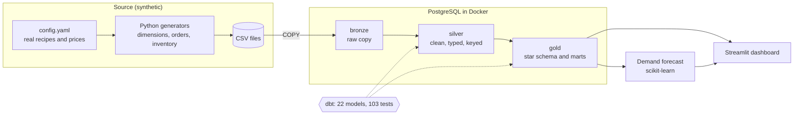
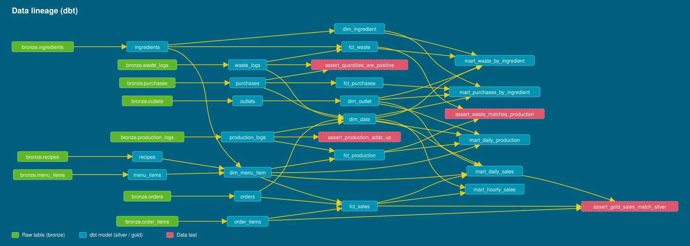
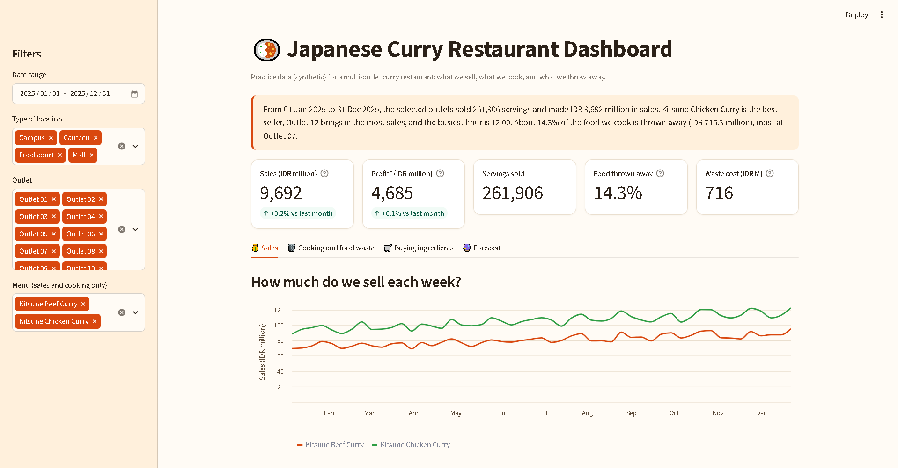
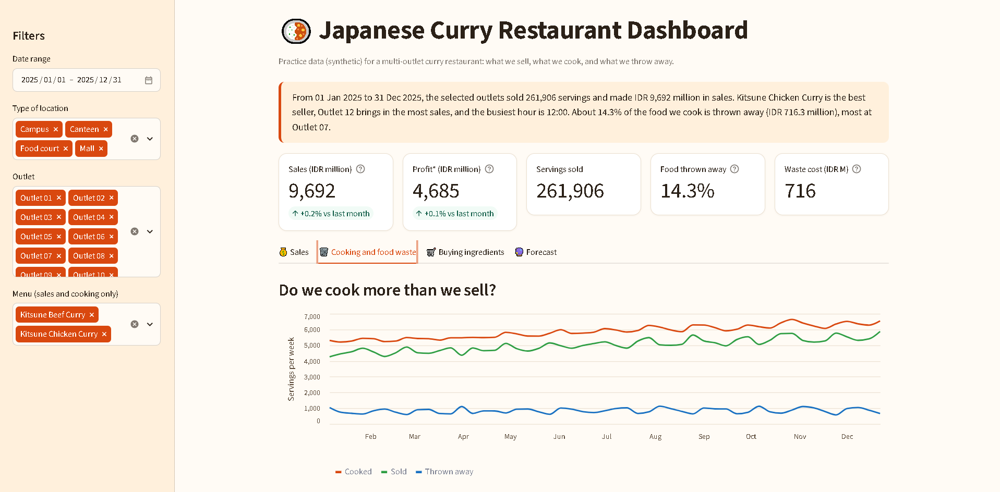
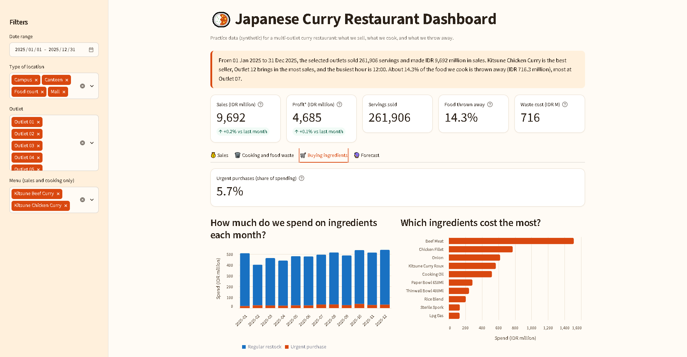
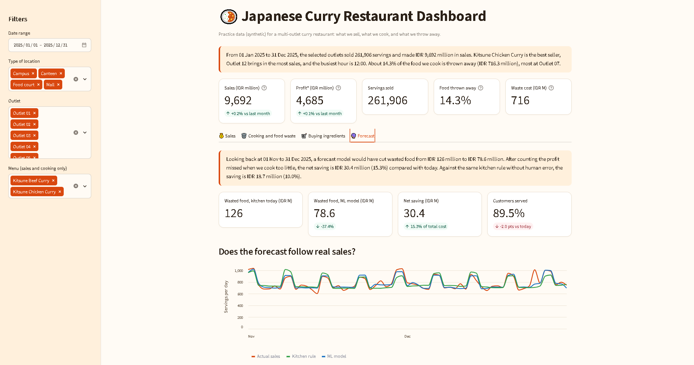

# Data Warehouse for Restaurant and Food Waste Prediction

[](https://github.com/spacemage666/restaurant-data-warehouse/actions/workflows/ci.yml)

This is an end-to-end data project. A multi-outlet Japanese curry restaurant: synthetic data generation, a PostgreSQL warehouse with bronze / silver / gold layers built by dbt, a Streamlit dashboard, and a demand forecast that shows how much food waste a better cooking plan could avoid.

The recipes and ingredient prices come from the costing workbook of a real small curry business. The sales are simulated, so no customer data is used or published.

## Results at a glance

| | |
|---|---|
| Simulated business | 17 outlets, 2 menu items, 12 months (2025), about IDR 9.7 billion in sales and 262k servings |
| Waste found in the data | 14.3% of cooked servings were thrown away, worth about IDR 716 million. Urgent purchases are 5.7% of ingredient spending |
| Pipeline | 22 dbt models and 103 data tests, all passing |
| Forecast (last 2 months, never seen in training) | Wasted food down 37% (IDR 126 M to 78.6 M). Net saving of 10.0% against the same kitchen rule, 15.3% against today's practice, at the cost of 2.0 points fewer customers served |

The forecast numbers come from a simulation with stated assumptions. They are described honestly in [the forecast section](#demand-forecast).

## Architecture



| Layer | Schema | What happens |
|---|---|---|
| Bronze | `bronze` | Raw CSV files copied as they are into 9 tables |
| Silver | `silver` | Types fixed, keys added, derived columns (for example `line_total`, `is_perishable`) |
| Gold | `gold` | Star schema (4 dimensions, 4 facts) and 5 ready-to-use marts |

## Tech stack

Python 3.12, PostgreSQL 16, Docker Compose, dbt Core (dbt-postgres), pandas, NumPy, scikit-learn, Streamlit, Altair. Developed in VS Code on WSL 2.

## Data model

- **Dimensions:** `dim_date`, `dim_outlet`, `dim_ingredient`, `dim_menu_item` (with cost per portion and gross margin).
- **Facts:** `fct_sales`, `fct_production`, `fct_purchases`, `fct_waste`.
- **Marts for the dashboard:** daily sales, hourly sales, daily production, waste by ingredient, purchases by ingredient.

The generators model the details that make food waste interesting: weekday and weekend demand, monthly growth, payday peaks, holidays, a kitchen that cooks from a rolling forecast, ingredients with shelf lives (including thawed meat), restock cycles, short deliveries and urgent purchases.

## Data quality

Every model has tests (`unique`, `not_null`, `relationships`, `accepted_values`). Custom tests check the numbers add up between layers:

- sold quantities are positive,
- portions wasted equal portions cooked minus portions sold,
- gold sales match silver sales,
- the value of overproduction waste matches the value of wasted portions (0.1% tolerance).

```bash
cd dbt_project && dbt build
```



## Dashboard

Plain-language labels and question-style titles, so it can be read without a data background.






## Demand forecast

**Goal:** decide how many portions each outlet should cook tomorrow, with less waste and few missed sales.

**Data:** one row per outlet, menu item and day. The target is the number of portions sold. Features use only what is known by the end of the previous day: sales 1, 7 and 14 days ago, rolling averages, weekday, payday period and outlet type.

**Method:** `HistGradientBoostingRegressor` with a Poisson loss, trained on sales relative to each outlet's typical level.

**Honest evaluation**
- Time-based split: training on January to August, tuning on September and October, and testing on November and December.
- The cooking safety factor is tuned per menu item on the validation months only. The final model is refit on training plus validation, then judged once on the test months.
- Baselines: same day last week, the kitchen's own rule (14-day average plus 5%), and the kitchen as simulated today (the same rule with about 10% random misjudgment, an assumption set in the config).
- Money simulation: wasted food costs the ingredient cost of the portion. A portion that customers wanted but was not cooked counts as lost profit.

**My findings**
- The model beats the kitchen rule by 10.0% in total cost over the two test months and cuts wasted food by 37%. It serves 2.0 points fewer customers, so this is a trade-off and not a free gain.
- A first version used a "public holiday" feature. With only three holidays in the training data (two quiet, one busy) it predicted a quiet Christmas on a busy day. Removing the feature improved the error, so it stays out until there is enough history.
- The first search range for the safety factor was too narrow and the best value sat on its edge. I widened it and tuned it per menu item.

**Limitations**
- The data is synthetic, so the results show the method, not a real business. Random noise in daily demand sets a floor that no model can beat.
- Lost sales are an assumption. A real kitchen might cook more on the spot instead.
- Two months of testing is short.

## Quick start

Try the dashboard only, with no database (it reads small sample files):

```bash
git clone https://github.com/spacemage666/restaurant-data-warehouse.git
cd restaurant-data-warehouse
python -m venv .venv && source .venv/bin/activate
pip install -r requirements.txt
streamlit run dashboard/app.py
```

Run the whole pipeline (Docker Desktop must be running):

```bash
cp .env.example .env          # then choose a password in .env
python run_pipeline.py        # database, data, bronze, dbt, exports, forecast
streamlit run dashboard/app.py
```

Useful options: `--skip generate` reuses existing CSV files, `--only dbt` runs one step, `--dry-run` shows what would run.

## Project structure

```
data_generator/   synthetic data (config.yaml holds recipes, prices and demand settings)
ingestion/        loads the CSV files into the bronze schema
sql/init/         schema and table creation, run when the database container is created
dbt_project/      silver and gold models, tests and macros
dashboard/        Streamlit app, chart code and small sample data files
ml/               features, training, evaluation and the money simulation
run_pipeline.py   one command for the whole pipeline
```

## Design decisions

- **Config-driven generators:** recipes, prices and demand live in one YAML file, so a scenario can change without touching code.
- **Exact schema names in dbt:** a custom macro makes models land in `silver` and `gold`, not in prefixed schemas.
- **Dashboard works without a database:** it falls back to small sample files, which makes the project easy to try and ready for an online demo.
- **Tests act as contracts:** dbt runs 125 checks on every build, including custom ones that confirm gold sales match silver and that waste totals match production.
- **Tests act as contracts:** 103 dbt tests run on every build, including custom ones that confirm gold sales match silver and that waste totals match production.
- **One command rebuilds everything:** `run_pipeline.py` regenerates data, loads it, builds the dbt models and trains the model in about a minute.
- **Automated checks:** every push rebuilds the project on a clean machine with GitHub Actions: database, data, dbt tests, forecast and a dashboard smoke test.

## Roadmap

- Orchestration with Airflow (one simple DAG).
- Online demo on Streamlit Community Cloud.

## Author

Built by [William Johanes](https://github.com/spacemage666) as a data portfolio project.
